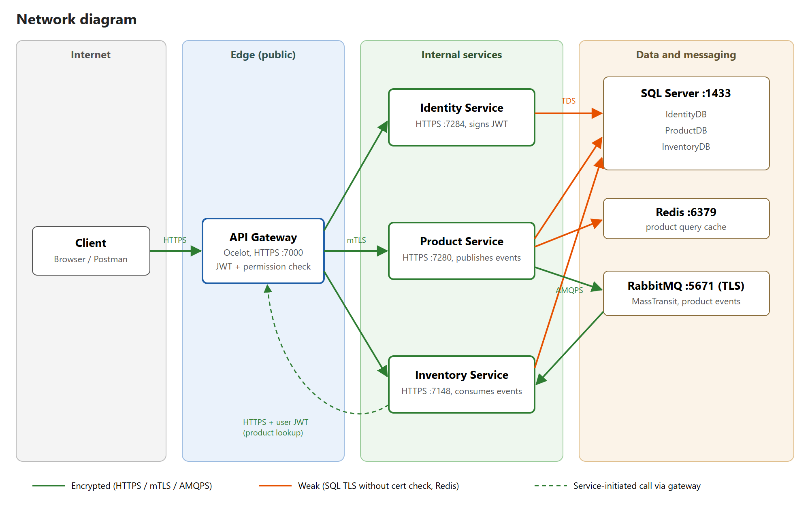
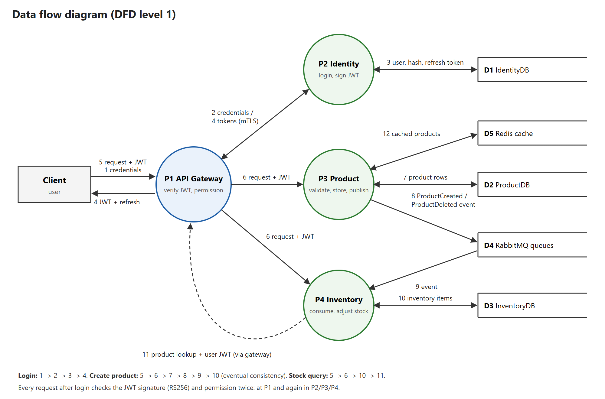
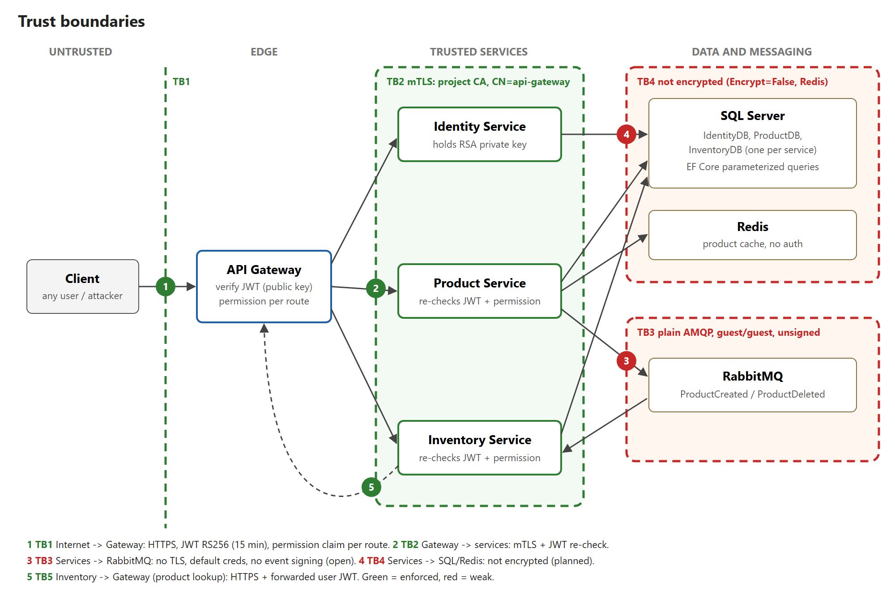

# Secure Microservices Inventory System

Final Project Report
MCSC 6002, Cybersecurity Architecture, Design, and Secure Software Development
Arman Akhmetov (N10045688), Mario Silveira

## 1. Introduction and Objectives

Splitting an application into microservices gives an attacker more targets: every service, the gateway in front of them, the message broker between them and each database. A common weakness is trusting the internal network, so that once a request is past the edge, nothing else checks it. For an inventory system this matters directly, because whoever can change stock levels or product records can cause financial loss.

This project follows Option 2 (Secure System Architecture and Prototype). We built an inventory system from three .NET services behind an Ocelot API gateway, with RabbitMQ events between the services. The objectives, taken from the proposal, were:

- authenticate every request at the gateway and check permissions again in each service;
- use short-lived signed access tokens with rotating refresh tokens;
- protect traffic between the gateway and the services, and the integrity of queue messages;
- validate all input;
- model the threats with STRIDE and test the controls against them.

## 2. System Overview

The Identity service manages users, roles and permissions and issues tokens. The Product service manages brands and products; when a product is created or deleted it publishes an event. The Inventory service consumes these events and creates or removes the matching stock items, so the two services stay consistent without calling each other (eventual consistency). All client traffic enters through the API gateway.

Each service has its own SQL Server database. The Product service caches its product list in Redis. The services use .NET 10 with Clean Architecture, CQRS through MediatR, Entity Framework Core, FluentValidation and ASP.NET Core Identity, and MassTransit for RabbitMQ. Two shared NuGet libraries hold the permission constants and the request and response contracts. For local runs, SQL Server, RabbitMQ and Redis start with Docker Compose and the services run with `dotnet run`.

## 3. Architecture Design

Figure 1 shows the network zones and which links are encrypted. Figure 2 is a level 1 data flow diagram with the three main flows: login, product creation (including the event to Inventory) and stock queries. Figure 3 marks the five trust boundaries used in the threat model.

The design follows three principles. Defense in depth: the gateway checks every token and permission, and each service checks them again, so a misconfigured route does not open a service. Least privilege: only the Identity service holds the token signing key. No implicit trust of the internal network, in line with zero trust architecture (Rose et al., 2020): services accept connections only from the gateway, and queue events must be signed.

## 4. Security Features Implemented

### 4.1 Authentication and access control

Access tokens are JWTs signed with RS256 and valid for 15 minutes. The Identity service signs them with an RSA private key; the gateway and the other services receive only the public key, so a compromised service cannot issue tokens. Every validator accepts only RS256, which blocks algorithm confusion attacks such as `alg=none` or HS256 (Sheffer et al., 2020). Refresh tokens are 32 random bytes, valid for one day and replaced on every use, so a used refresh token is rejected.

Authorization is permission based. The gateway checks the permission claim required by each route before forwarding the request, and the service checks the same permission again with its own `[HasPermission]` attribute. Passwords must have at least 12 characters with 6 different ones, following the length-over-composition advice in NIST SP 800-63B (Grassi et al., 2017). After 5 failed logins an account is locked for 15 minutes, and the gateway allows at most 5 login or refresh requests per minute per IP address. Wrong passwords, unknown users and locked accounts all get the same message, so a response does not reveal whether an account exists or is locked.

### 4.2 Secure communication

Clients reach the gateway over HTTPS, with HSTS outside development. Between the gateway and the services we use mutual TLS. A project certificate authority issues a client certificate to the gateway, and each service accepts only a client certificate issued by that CA with the name `api-gateway`. The gateway in turn accepts only service certificates from the same CA and checks the host name. The services no longer listen on plain HTTP, so even a host inside the network cannot call a service directly.

### 4.3 Hashing and integrity

Passwords are stored as salted PBKDF2 hashes by ASP.NET Core Identity. Queue events carry an HMAC-SHA256 signature (Krawczyk et al., 1997) over the event type, a timestamp and the message body. The Inventory service verifies the signature in a filter that runs before every consumer and rejects events that are unsigned, altered or older than five minutes. Rejected events go to an error queue as evidence instead of being retried.

### 4.4 Input validation

Request bodies in the Identity and Product services are validated with FluentValidation for type, length and range; the Inventory service has no validators yet. Entity Framework Core sends all queries with parameters, which prevents SQL injection. Product quantity is limited to 1 to 1000, because the Inventory service creates one record per unit. The consumer checks the same limit again, in case an event bypasses the Product service.

### 4.5 Secrets and error handling

No password or key is committed. Infrastructure and seed passwords live in a git-ignored `.env` file and in each service's .NET user secrets; signing keys and certificates are kept outside all repositories. RabbitMQ uses its own account instead of the default guest user, Redis requires a password and SQL connections are encrypted, although the server certificate is not yet validated. The gateway returns generic error messages, also in place of server errors from the services, logs the details server side and removes headers that reveal the server software. It also adds `X-Content-Type-Options`, `Cross-Origin-Resource-Policy` and `Cache-Control: no-store`.

## 5. Threat Modelling and Mitigation

We applied STRIDE (Shostack, 2014) to each component and trust boundary and rated each threat by likelihood and impact (Low, Medium or High). The model lists 26 threats; Appendix A has the full table. At the end of the project, 14 are mitigated, 6 partly mitigated, 5 planned and 1 not applicable.

The highest risks at the start were forged tokens (a signing secret shared by four services and committed to git), direct calls to services that bypass the gateway, password guessing, forged or altered queue events and an unbounded quantity that let one event create any number of records. All of these are now mitigated and tested.

Broken object level authorization, the first item in the OWASP API Security Top 10 (OWASP Foundation, 2023), was a focus of the proposal. In the final data model no record belongs to a single user, so the threat does not apply; the related function level checks are covered by threat E1 and tested.

The main remaining risks are:

- refresh tokens are stored in plain text in the database;
- RabbitMQ traffic is not encrypted, and a signed event can be replayed within the five-minute window;
- the HMAC key is shared, so the Inventory service could also forge events;
- there is no audit log of who changed products or stock;
- account lockout lets an attacker lock a known account on purpose.

## 6. Testing and Validation

We tested in four ways. A scripted suite of 33 attack cases (Appendix B) runs against the live system, and each case maps to a threat ID. Semgrep scanned the source of all seven repositories, Gitleaks scanned their git history and OWASP ZAP ran an authenticated active scan of all 19 gateway routes.

All 33 attack cases pass. They cover forged, expired and wrongly signed tokens, privilege escalation, refresh token reuse, rate limiting and lockout, direct calls to services without the gateway certificate, SQL injection and oversized or malformed input, and events published straight to RabbitMQ by an attacker with broker credentials.

Semgrep reported five findings: four GitHub Actions referenced by a tag instead of a commit, which we accept as a low supply chain risk, and the deliberate `ValidateLifetime = false` in the refresh flow. Gitleaks found the old HS256 secret in the history of four repositories; it is no longer used and test A4 shows it is rejected. ZAP found no high risk issues. Its one medium alert is a false positive caused by our own SQL injection test data, and the missing HSTS header is expected in development mode.

Testing also found real defects, which we fixed and retested. Forged tokens crashed the request instead of returning 401, because the framework placed the authentication middleware before our header middleware. The product list stayed cached for an hour after changes. ZAP reported three missing response headers and an unneeded static page on the gateway. A final end-to-end check found that the Inventory service could not call the Product service through the gateway, and that the resulting error page leaked a stack trace and the caller's token; the gateway now uses a certificate from our own authority and hides error bodies from the services. A restore on a clean machine also showed that our shared libraries were not on nuget.org, where unrelated packages use the same names: the build silently took a stranger's AuthLibrary 2.0.0. Each service now ships the exact packages and maps those names to them only.

## 7. Challenges and Lessons Learned

The largest delay came from dependencies. MassTransit 9 requires a commercial license, and two services failed at startup until we moved to version 8, which is open source. MediatR 14 has a similar license that allows only development use. Checking licenses early would have saved time.

Several defects appeared only when we attacked the running system: the middleware ordering crash and the stale cache both passed the build and normal use. Running negative tests early is worth the effort. We also learned to verify the tools themselves. Our first ZAP scan never sent the token and tested only the login wall, which we noticed only by checking the gateway logs.

## 8. Conclusion

The prototype delivers the security controls promised in the proposal: RS256 tokens with short lifetimes and refresh rotation, permission checks at the gateway and in every service, mutual TLS between them, signed queue events, input validation and protection against password guessing. The threat model and the test results show how each control maps to a threat and that it works. The remaining work is encryption of RabbitMQ traffic, hashed refresh tokens with a revoke endpoint, an audit log and container images for the services themselves.

## Team Contributions

Mario Silveira built the Identity, Product and Inventory services, the shared libraries and their build pipelines. Arman Akhmetov built the token and gateway security (RS256 signing and validation, route permissions, mutual TLS, rate limiting, lockout and password policy, error handling), the message signing, the local infrastructure, the threat model and diagrams, and the testing, and wrote this report.

## References

Grassi, P. A., Fenton, J. L., Newton, E. M., Perlner, R. A., Regenscheid, A. R., Burr, W. E., Richer, J. P., Lefkovitz, N. B., Danker, J. M., Choong, Y.-Y., Greene, K. K., & Theofanos, M. F. (2017). Digital identity guidelines: Authentication and lifecycle management (NIST Special Publication 800-63B). National Institute of Standards and Technology. https://doi.org/10.6028/NIST.SP.800-63b

Krawczyk, H., Bellare, M., & Canetti, R. (1997). HMAC: Keyed-hashing for message authentication (RFC 2104). Internet Engineering Task Force. https://doi.org/10.17487/RFC2104

OWASP Foundation. (2023). OWASP API security top 10 2023. https://owasp.org/API-Security/editions/2023/en/0x00-header/

Rose, S., Borchert, O., Mitchell, S., & Connelly, S. (2020). Zero trust architecture (NIST Special Publication 800-207). National Institute of Standards and Technology. https://doi.org/10.6028/NIST.SP.800-207

Sheffer, Y., Hardt, D., & Jones, M. (2020). JSON Web Token best current practices (RFC 8725). Internet Engineering Task Force. https://doi.org/10.17487/RFC8725

Shostack, A. (2014). Threat modeling: Designing for security. Wiley.

## Appendix A. STRIDE Threat Model

@table ../threat-model.md Threats

## Appendix B. Security Test Results

@table ../testing.md Attack cases
